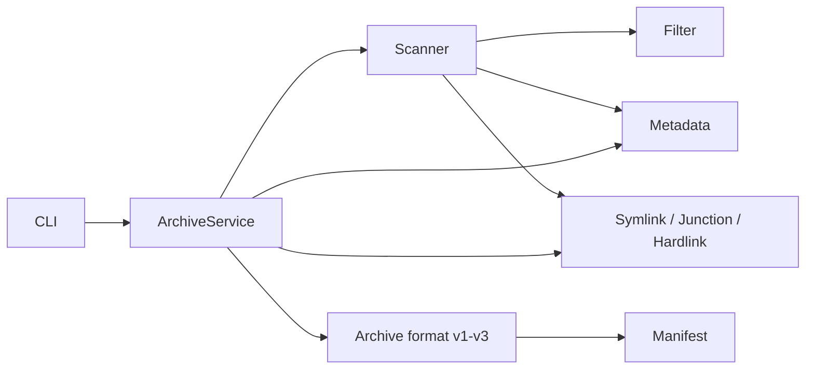
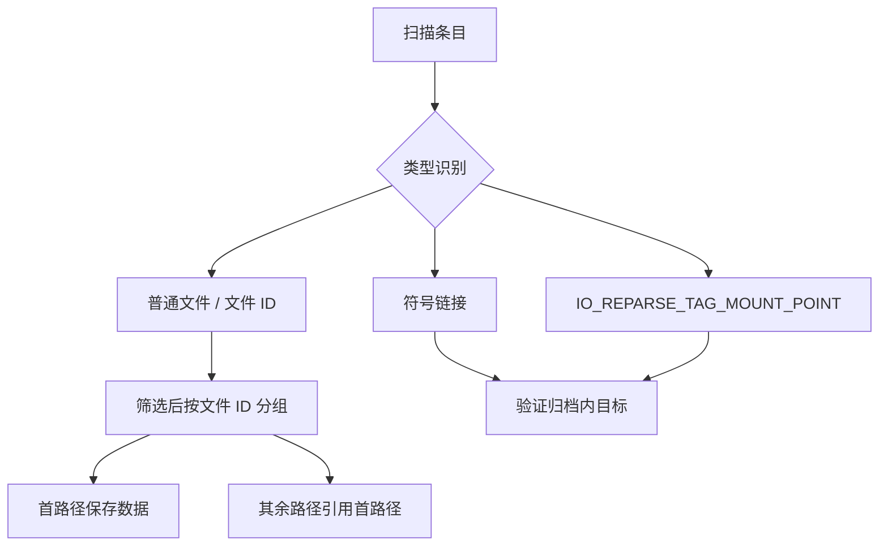

# BackupMaster 系统设计（v0.3.0）

## 模块职责

- `archive_service`：备份、列表、校验、恢复的任务编排和失败回滚。
- `archive_format`：v1/v2/v3 小端序编解码、长度上限和流式校验。
- `scanner` 与 `filter`：不跟随重解析点地扫描源树，组合筛选并补齐依赖。
- `metadata`：Windows 时间、属性、owner、primary group 和 DACL 的捕获、编码与恢复。
- `symlink` 与 `special_files`：符号链接、目录联接、文件 ID 和硬链接的平台操作。
- `manifest`：重复路径、父子关系、引用类型、目标存在性和引用环校验。



## v3 数据布局

```text
archive_header = magic[8] + version:u32 + entry_count:u64
entry_header   = type:u8 + path_size:u32 + metadata_size:u32
               + data_size:u64 + checksum:u64
entry          = entry_header + path + metadata + data
```

所有整数按小端序保存。FNV-1a 64 从元数据开始，再连续计算条目数据。`list` 可以跳过
普通文件数据；`verify` 和 `restore` 必须流式读取全部数据。元数据和引用目标都有独立
上限，所有归档路径必须为安全 UTF-8 相对路径。

Windows 元数据块带平台号和模式版本，保存四个 `FILE_BASIC_INFO` 时间、文件属性、
owner SID 文本和自相对安全描述符。安全描述符只包含 owner、primary group 和 DACL。

## 特殊文件语义



目录联接在归档中不保存原始绝对目标，而保存源树相对目标。恢复时按“目录、文件、
硬链接、符号链接/目录联接、元数据”的顺序执行，避免写入过程经过尚未验证的链接。
任一核心恢复步骤失败都会清理本次创建的内容。

## 筛选数据流

路径排除在遍历阶段剪枝。其余路径、类型、名字、时间、owner 和尺寸条件在候选项完成
类型及必要元数据采集后组合判断：同类规则为 OR，不同类规则为 AND。随后补齐祖先
目录以及被选链接的归档内目标；显式排除不得被依赖补齐覆盖。硬链接关系只在最终选择
集合中建立。
